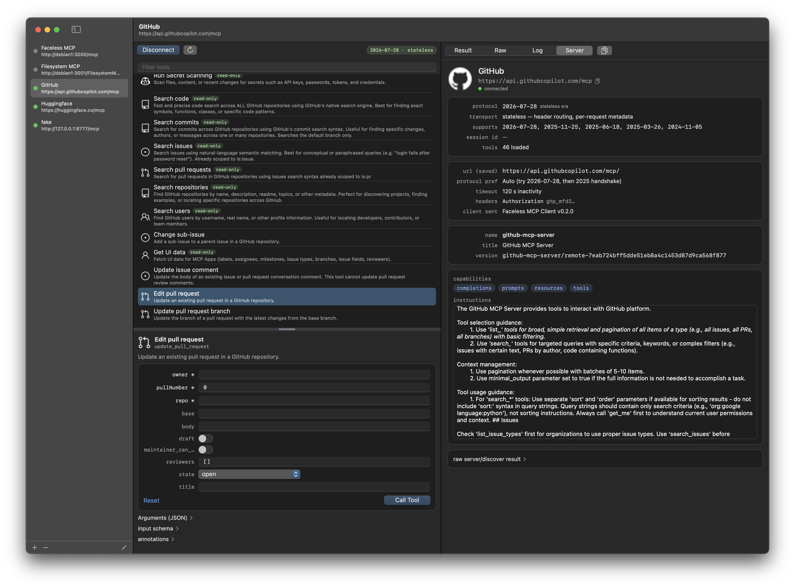
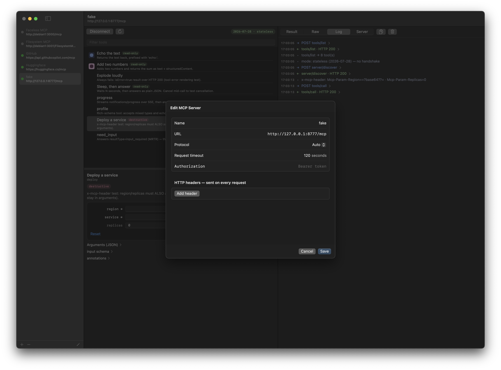
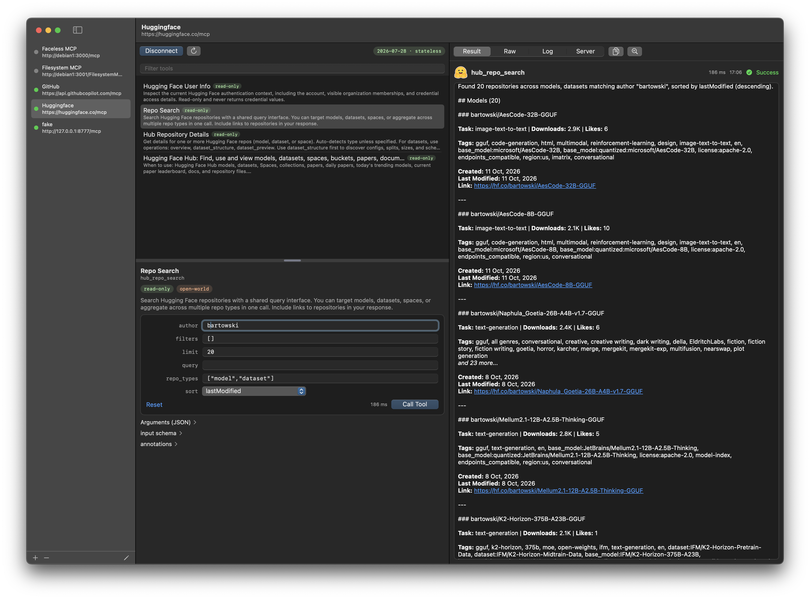
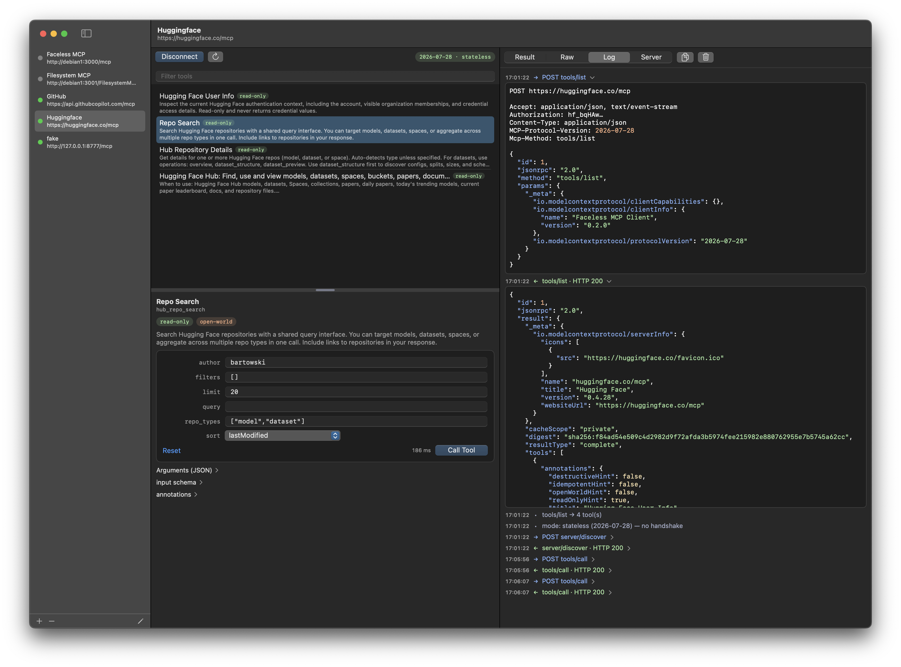

# Faceless MCP Client



A native macOS app for debugging and testing MCP servers over HTTP.
It connects to a server, lists its tools, calls them, and shows exactly what crossed the
wire. It is a debugger, not a chat client: no LLM, no conversation, no stdio.

Source and releases: <https://github.com/facelessfish/mcp-client>

- Native SwiftUI/AppKit app. One binary, no dependencies, builds with the plain Swift
  toolchain — no Xcode project needed.
- Speaks both generations of the MCP HTTP transport: the 2025 session era
  (initialize handshake, `Mcp-Session-Id`) and 2026-07-28 stateless (header routing,
  per-request metadata). **Auto** detects the right one and will not silently downgrade
  a conformant modern server.
- Plain JSON and SSE answers are both handled. Progress notifications stream live next
  to the Call button.
- Nothing is hidden: every request, response, header and notification is in the Log,
  complete. No body is ever truncated.
- Dynamic argument forms generated from each tool's inputSchema, two-way synced with a
  raw JSON editor. On Call, the JSON wins.
- Tool icons, titles and annotations are shown as announced. Only what the server
  actually sent is displayed.
- macOS 14+.

Please note: this is a development tool meant for LAN use. Authorization tokens and
custom headers are stored in clear text in the config file.

## Build & run

Requirements: macOS 14+, Xcode Command Line Tools (`xcode-select --install`).

```
$ git clone https://github.com/facelessfish/mcp-client
$ cd mcp-client
$ bash build.sh                     # → build/Faceless MCP Client.app, opens it
```

`build.sh` makes a real .app bundle (Info.plist, icon, ad-hoc signature) and builds
release by default. Pass `debug` as its first argument for a build you can attach a
debugger to.

## Try it immediately

A fake MCP server for testing is included:

```
$ python3 scripts/fake_server.py            # session-era server on :8777
```

Add a server `http://127.0.0.1:8777/mcp` with protocol **Auto**, Connect, and try:
`echo` (text result), `add` (structured result), `boom` (tool error), `sleepy`
(Cancel mid-call), `progress` (live SSE progress), `profile` (the argument form),
`picture` (an image — right-click to save it, or drag it onto the Desktop).
More server flavours (`--stateless`, `--require-auth`, `--expire-after`) are described
in [Description.md](Description.md).


## Adding a server



⌘N, or the **+** button under the sidebar. The editor asks for:

- **Name** — anything you like.
- **URL** — the server endpoint, `http://` is assumed when you leave the scheme out.
- **Protocol** — Auto, or force a specific dated version.
- **Request timeout** — inactivity seconds (1–3600, default 120). SSE keep-alives keep
  long calls alive, so this only fires on a silent connection.
- **Authorization** — the bearer token, if any.
- **HTTP headers** — any number of name/value pairs, sent on every request.

Servers, their order, and the pane sizes are saved automatically. Right-click a server
for Edit / Duplicate / Delete; drag rows to reorder.

## Calling a tool

Select a server, press **Connect**. The header chip shows what was negotiated
(`version · mode`). Reload the tool list any time with **↻**; filter with the text
field at the top (× button clears it).

Select a tool, fill the form or edit the JSON (they stay in sync — open the
*Arguments (JSON)* disclosure), then **Call Tool** or ⌘↵. Long calls can be
**Cancel**led; progress notifications appear next to the button while a call runs.

## Reading the output

<p float="left">
  
  
</p>

- **Result** — the reply's main body: text (pretty-printed when it is JSON) and any
  images, decoded. The header carries the call's facts — how big the reply was (hover
  for the exact byte count), how long it took, when, and how it went: Success / Tool
  error / Failure / Cancelled.
- **Images in a reply** — right-click one for **Save Image…** (or Copy Image), or drag it
  out as a file onto the Desktop. The file holds the bytes the server sent, not a
  re-encode of the pixels on screen; the base64 behind them stays in Raw.
- **Raw** — the exact response body, whole, under the very same header: one call,
  framed identically at both depths, so nothing moves when you go looking for bytes.
  This is also the tab to ⌘F in when you are looking for something in a big payload.
- **Log** — everything that crossed the wire: `→` request, `←` response or error,
  `•` note. Requests and replies carry the size of their body on the right of the row
  (hover for the exact count, and Copy writes it in full) — the size above a reply is
  the same number as its `←` row. Click a row to expand its body.
- **Server** — the connection profile: negotiated version, transport, session id, what
  the server announced about itself (identity, capabilities, instructions), and your
  saved config.

The Copy button copies whatever the current tab shows, in full. ⌘F finds in the Result
and Raw tabs. The tab you picked sticks when you switch servers.

## Shortcuts

| Key | Action |
|---|---|
| ⌘N | New server |
| ⌘↵ | Call tool |
| ⌘F | Find in text |

## Files

Settings live in `~/Library/Application Support/Faceless MCP Client/servers.json` —
plain JSON, hand-editable. A value the app can't understand falls back to its default
instead of failing the load. A file it cannot parse at all is renamed to
`servers.json.bad` and reported in the sidebar rather than overwritten.

## Limitations

- HTTP transport only. No stdio. The 2024 HTTP+SSE transport is not supported (the Log
  says so if a server still uses it).
- No OAuth 2.1 yet — static bearer tokens and custom headers only.
- Server→client requests (sampling, elicitation, roots) are answered "method not found"
  and logged. An `input_required` result is flagged, not handled.
- No proxy configuration, one window, headers stored in clear text. It's a dev tool.

## History

### 0.2.1
- The Raw tab wears the Result tab's header.
- The header shows the size of the reply, left of duration and time; hover for the
  exact count.
- Log rows for requests and replies show the size of their body; Copy writes it too.
- Reply images: right-click to **Save Image…** or Copy, or drag the image out as a file.
- A folded tool description matches an inline one.
- Server instructions look the same whether they fit or scroll.
- Test server: new `picture` tool returning an image.

### 0.2
- BSD-2-Clause license.
- The About panel shows the version and links to the repository.
- Tool filter is a plain text field now, with a clear button.
- Long tool descriptions fold into a "description" disclosure instead of
  standing in the way as a scroll box.
- The server editor opens with nothing focused — the name is no longer
  pre-selected.
- "Show Tab Bar" / "Show All Tabs" removed — one window is all this app has.

### 0.1
- Session (2025-03-26 … 2025-11-25) and stateless (2026-07-28) HTTP transports with
  safe Auto detection.
- tools/list with pagination, icons, titles and annotations.
- Dynamic argument form, two-way synced with the JSON editor.
- SSE with live progress, Cancel, automatic session re-handshake on expiry.
- Server profile from `initialize` or `server/discover`, per-request metadata
  conformance for 2026, x-mcp-header mirroring, MRTR/resultType flagging.

## License

BSD-2-Clause. See [LICENSE](LICENSE).

## More

Architecture, protocol implementation notes, decisions and the full test checklist are
in [Description.md](Description.md).
